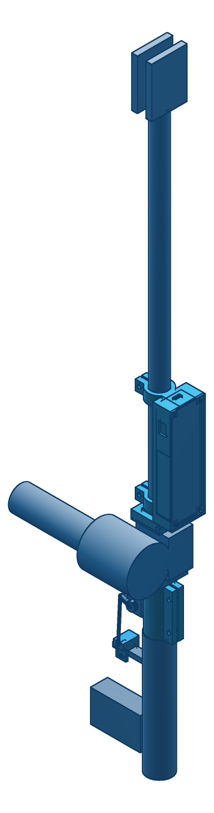

# K1 trash reacher: phase-1 grabber actuation

A commercial 32-inch reacher, its trigger pushed by a DS3225 servo, held by the K1
through the [tool cuff](../k1-ball-cuff/) the same way a shovel handle is held.
The reacher itself is not modified: every part clamps on.



`render/actuation.png` shows the servo, horn, pushrod and trigger shoe from the trigger side.

**Every reacher dimension here is a placeholder** (see [Confirm](#dimensions-cam-must-confirm)).
They all live in `params.loon`: change them there, run `build.sh`, and every part follows.

## Parts

All printed in PETG. Masses are the vcad solid volume × 1.27 g/cm³ (an upper bound) plus
the vcad-slicer estimate at 0.2 mm layers, 4 walls and 40 % infill. Where the slicer
estimate came out above the solid mass (thin-walled parts print essentially solid),
the solid mass is used.

| part | file | STL | volume cm³ | solid g | printed g | print orientation |
|---|---|---|---|---|---|---|
| servo mount | `servo-mount.loon` | `stl/servo-mount.stl` | 64.66 | 82.1 | 58.4 | handle-butting face down |
| trigger shoe | `trigger-shoe.loon` | `stl/trigger-shoe.stl` | 4.20 | 5.3 | 4.0 | boss down (STL pre-flipped) |
| MCU + battery pod | `pod.loon` | `stl/pod.stl` | 55.69 | 70.7 | ~71 | proximal end down, 146 tall |
| pod lid | `pod-lid.loon` | `stl/pod-lid.stl` | 17.99 | 22.8 | 11.9 | plate down (STL pre-rotated) |
| cuff sleeve | `cuff-sleeve.loon` | `stl/cuff-sleeve.stl` | 32.49 | 41.3 | ~41 | flange down |
| cuff collar | `cuff-collar.loon` | `stl/cuff-collar.stl` | 10.82 | 13.7 | 10.0 | flat |
| **total** | | | 185.85 | **236** | **~196** | |

`k1-trash-reacher.3mf` holds all six on one 256 × 256 plate (Bambu/Prusa, written by `vcad kit`).

Every STL is exported in its print orientation. vcad's `floating_floor` check passes it
support-free, and an independent signed-volume and edge-manifold check gives zero open
edges with volumes equal to `eval-json`. Four parts were also checked against hand
arithmetic: servo mount (64660.6 vs 64660.6), trigger shoe (4203.8 vs 4203.6), cuff
collar (10818.1 vs 10818.1) and pod lid (17987.1 vs 17987.1, after the check caught a
notch cutting 1 mm into the plate). The pod's switch-cutout change matched its
hand-computed delta exactly (−293.1 mm³).

## How it works

**Actuation is a horn-to-trigger pushrod, not a cable.** The servo mount clamps on the
shaft just distal of the handle housing, so it sits in front of the trigger. A finger
closes a reacher by pulling the trigger's front face back toward the grip. A rod from
the servo horn pushing on that same face does the same job directly, in compression,
with no pulley or redirect. The parts are a stock 25T metal arm horn, an M3 ball link
in its r = 15 hole, M3 threaded rod, and an M3 ball link screwed into the printed
trigger shoe. The shoe is a U-channel on the trigger's front face, open at the back so
the trigger guard doesn't have to open, and held on by one zip tie. You set rod length
on the threads with the servo at mid-travel and the jaws half closed.

**Travel.** A 120° horn sweep, symmetric about the rod line, moves the pin
2 × 15 × sin 60° = **26.0 mm**, which covers the 25 mm stroke.

**Servo torque margin (DS3225).**

| | value |
|---|---|
| trigger force (placeholder) | 20 N |
| peak demand, mid-sweep, full 15 mm arm | 20 N × 15 mm = 0.30 N·m = **3.06 kg·cm** |
| demand at the firm-close end, effective arm 15 × cos 60° = 7.5 mm | 1.53 kg·cm |
| DS3225 stall at 6.0 V (buck setpoint) | 21.5 kg·cm → **7.0× margin** |
| DS3225 stall at 6.8 V | 25 kg·cm → 8.2× margin |
| reaction about the shaft on the mount (20 N × ~30 mm) | 0.6 N·m, carried by the M4 split collar |

The geometry helps in the right place: the trigger stiffens into the firm close just
where the horn's effective arm is shortest. If Cam's trigger turns out to need 40 N,
the margin is still 3.5×. Hold the closed position at reduced command, not at stall.

**Electronics.** The battery only drives the servo. The MCU is powered by the robot
through the same USB-C cable that carries serial, so a servo stall can't brown out
the controller. Ground is shared through USB. The DS3225 accepts 3.3 V logic on its
signal line.

**Cuff interface.** The cuff's boss already has a tool socket: a 25.8 square tunnel,
52 long, along the cuff's X axis, made for a 1-inch square handle. The kit adapts to
that socket rather than replacing it, so the print-validated cuff stays exactly as it
is. `cuff-sleeve` is a 25.3 square sleeve with a shaft bore, an integral 40-square
flange stop, and two radial M3 set screws in heat-set inserts that fix it to the
shaft. `cuff-collar` is the second axial stop, pinched onto the sleeve's square tail.

- *Reacher rotation about its own axis, relative to the cuff:* **positive**. A square
  sits in a square, with four clockings at 90°, so no friction is involved.
- *Cuff rotation on the K1 hand ball about the forearm axis:* **friction only, and no
  adapter can change that** (ball and bump-stop rod are both surfaces of revolution
  about that axis; see `../k1-ball-cuff/tool-coupling-first-principles.md`). The kit
  handles it by not asking for that torque:
  1. Mount the sleeve at the loaded reacher's balance point, so gravity puts
     ~no moment about the forearm. With the placeholder masses, the kit COM is at
     z ≈ 137 mm (from the handle's front face) against the cuff at z = 110. The
     27 mm offset gives 0.71 kg × 9.81 × 0.027 = **0.19 N·m** worst case.
  2. Run the bolted cuff, **rev E.1.1** (two M4 at 0.15 N·m, ~1.1 kN clamp,
     ~14 N·m friction capacity per the first-principles doc). Don't run the E.2
     ratchet latch: its ~50 N spring preload scales to ~0.6 N·m, which slips under
     almost any pick.
  3. Worst-case task load: 0.5 kg of trash at the jaw tips, 0.6 m from the cuff, with
     the reacher horizontal and square to the forearm, is 2.9 N·m. Adding the 0.19
     N·m offset, the bolted cuff has **~4.5× margin**. Above that the cuff slips
     on the ball as a mechanical fuse, which is the intended failure mode.

The cuff puts the reacher axis 44.9 mm from the ball center, perpendicular to the forearm.

## Stations along the shaft

Shaft frame: Z along the shaft, +Z toward the jaws, z = 0 at the handle housing's front
face, trigger side −Y.

| station | z (mm) |
|---|---|
| handle housing | −170 .. 0 |
| servo mount (butts the housing) | 0 .. 64 |
| cuff sleeve flange / cuff tunnel / collar | 70 .. 84 / 84 .. 136 / 136.5 .. 148.5 |
| pod | 152 .. 298 |
| jaws | 640 .. 710 |

The sleeve is the station to move: it goes at the measured balance point (step 1
above). If that lands inside the pod's span, slide the pod distally.

## BOM

| qty | item | notes |
|---|---|---|
| 1 | 32-inch reacher, pistol grip | Cam's; dimensions to confirm below |
| 1 | DS3225 servo, 25 kg·cm, metal gear, 180° | any 40 × 20 × 40.5 standard-size 25 kg·cm part fits the cradle |
| 1 | 25T aluminum single-arm horn, hole at r = 15 | usually in the servo box |
| 2 | M3 ball link (RC rod end) with M3 ball stud | one into the horn, one into the shoe's pilot |
| 1 | M3 threaded rod, ~80 mm (cut to ~60) + 2 M3 jam nuts | pushrod |
| 1 | Waveshare RP2040-Zero **or** ESP32-C3 SuperMini | USB-C faces the pod's +Z wall |
| 1 | 6 V ≥ 5 A step-down, e.g. Pololu D36V50F6 | servo supply; check its outline against the 42 × 46 electronics bay |
| 1 | 2S 18650 holder with leads (~77 × 41 × 20) | |
| 2 | 18650 cells, matched, ≥ 2500 mAh | |
| 1 | 2S BMS, ≥ 5 A | |
| 1 | JST-XH 3-pin balance lead | charge on a hobby charger through the −X wall slot |
| 1 | KCD11 mini rocker switch, 6 A (10 × 15 cutout) | battery positive; an SS12 slide (0.5 A) is too small |
| 1 | USB-C cable to the robot | serial and MCU power |
| 4 | M4 × 20 + nut | 2 servo-mount collar, 2 pod collars |
| 4 | M3 × 10 self-tapping (servo ear screws) | into 2.5 mm pilots |
| 4 | M3 × 10 | lid into the pod bosses (2.5 mm pilots) |
| 2 | M3 × 6 set screw + M3 heat-set insert (4.1 hole, ≤ 5.7 long) | cuff-sleeve flange |
| 1 | M3 × 50 + nut | cuff-collar pinch |
| 1 | zip tie, ≤ 3.6 wide | trigger shoe |
| 1 | K1 ball cuff rev E.1.1 + 2 M4 | `../k1-ball-cuff/` |

Estimated tool mass with the placeholder 300 g reacher: **~0.71 kg** (printed parts 0.20,
servo 0.065, cells and electronics ~0.13, linkage 0.015).

## Print settings

PETG, 0.4 mm nozzle, 0.2 mm layers, **4 walls**, 5 top / 5 bottom, 40 % gyroid,
240 °C / 80 °C bed (a P1S profile is fine). No supports on any part. Use the
orientations already in the STLs and 3MF.

- Clamp bores carry 0.25 mm radial fit on the shaft, the same constant measured for
  the cuff's cavities. Bolts close the 2.0 mm slits from there.
- The sleeve-in-tunnel fit is 0.25 per side (25.3 in 25.8). If it binds, drop
  `sleeve-sq` by 0.1. If it rattles, the collar pinch takes it up.
- Seat the heat-set inserts before you thread the shaft through.

## Dimensions Cam must confirm

All are in `params.loon`, tagged `[CONFIRM]`:

| param | placeholder | what it drives |
|---|---|---|
| `shaft-d` | 22.0 mm | every clamp bore (19–22 is typical). The sleeve needs `shaft-d` ≤ 22.6 to keep a wall inside the 25.3 square |
| `reacher-len` | 810 mm | assembly only |
| `handle-len` | 170 mm | assembly only |
| `trigger-drop` | 45 mm (shaft axis to the finger point) | pushrod length, horn clocking |
| `trigger-travel` | 25 mm | horn sweep (26 mm available at 120°; more travel means a bigger sweep or a longer horn hole) |
| `trigger-force` | 20 N (firm close) | servo margin (table above) |
| `trigger-w`, `trigger-t` | 12 × 6 mm at the finger point | trigger-shoe channel |
| `reacher-mass` | 0.30 kg | balance point, i.e. where the sleeve goes |
| — | trigger front face 40 mm behind the housing's front face | shoe position along z |
| — | free shaft length between handle housing and jaws | must fit mount + sleeve + pod, 298 mm |

Also measure: the reacher's balance point with the kit fitted, and whether the
housing's front face is flat enough for the servo mount to bear on.

## Build

```
cargo build --release -p vcad -p vcad-render   # needs sibling tang/ and phyz/
hardware/k1-trash-reacher/build.sh             # STLs, 3MF kit, volumes, renders
```

`assembly.loon` imports the exported STLs, so run the part exports first; `build.sh`
does this in order.

## vcad issues found on the way

- **#1042**: an axial slit through the thin wall between a bore and a flat exports
  non-manifold with the wrong volume (+62 mm³ at 1.5 mm width; 2.0 mm happens to come
  out clean). The cuff sleeve was redesigned around it: set screws, no slit.
- **#1043**: on `import-mesh`, nested transforms get reordered and a third, outer one
  is dropped. `assembly.loon` uses one translate over one rotate per part.
